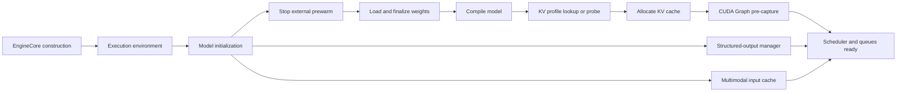
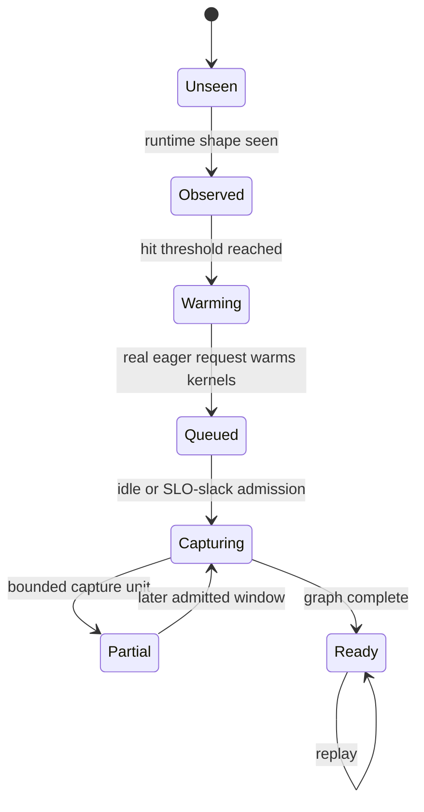

# IgniteServe Architecture

## Startup Pipeline

IgniteServe treats startup as a dependency-constrained execution problem rather than one monolithic initialization call.



The executable plan contains two stages and 25 nodes:

1. **Bootstrap DAG (13 nodes):** EngineCore construction, plugins, executor shell, worker preparation, CUDA/distributed initialization, compiler-helper prewarm, model-runner construction, and state probing.
2. **Runtime DAG (12 nodes):** model creation, prewarm handoff, weight loading, compilation, KV profiling/allocation, CUDA Graph pre-capture, and serving-manager construction.

Dependencies are correctness constraints. In particular, compilation waits for finalized weights because the compile-only dummy forward reads parameters while loading and post-load processing mutate them. Earlier experiments that overlapped these operations produced nondeterministic outputs and were rejected.

## Stage-Separated Compilation

The native vLLM profiling path couples the first compiled execution with peak-memory probing. IgniteServe separates it into:

- **Compilation phase:** TorchDynamo tracing, vLLM piecewise graph partitioning, TorchInductor lowering/code generation, optional structural reuse, and best-configuration resolution.
- **KV profile phase:** either a manifest-keyed persisted result or a real maximum-shape profiling forward pass.

### S0 and S4

- **S0** is the stage-separated baseline. It runs compile-only first, then performs a real profile forward when KV memory must be measured. Semantic caches and canonical subgraph reuse are disabled unless explicitly enabled.
- **S4** enables the full startup resource path: canonical subgraph reuse, semantic Triton best-config reuse, transformed-code reuse, data-flow metadata restore, compile-cache aliasing, and KV-profile reuse.

On a miss, S4 falls back to the correct native operation and persists the result. A cache hit is accepted only under the corresponding semantic/configuration checks.

## Startup Resource Store

`VLLM_STARTUP_RESOURCE_ROOT` controls a single root with typed subdirectories:

```text
vllm_startup_resources/
  best_config/                 # kernel_name + configs_hash selections
  transformed_code/            # transformed TorchDynamo artifacts and index
  kv_profile/                  # configuration-keyed available KV bytes
  parallel_compile_metadata/   # subgraph inputs, fake-run map, reuse metadata
  cuda_graph_hotspots/          # workload-specific hit/cost profiles
  startup_orchestration/        # DAG plans and learned timing information
```

This directory is runtime state and is intentionally ignored by Git. Store it on persistent low-latency storage for repeated launches.

## Adaptive CUDA Graph Lifecycle



Offline materialization records full and Top-99% shape distributions. An online instance pre-captures only compatible high-value shapes. Runtime matching proceeds in this order:

1. exact captured graph;
2. registered vLLM padding target;
3. sparse upward padding satisfying the maximum padding ratio and measured GPU-cost constraint;
4. eager fallback.

Unknown or incompatible profiles are ignored rather than trusted. Dynamic capture work is admitted at true idle or when request-level TTFT/TPOT slack covers a conservative capture estimate. A real eager request performs runtime warmup; formal stream capture remains a separate operation.

## Weight I/O Handoff

Weight prewarm begins near `AsyncEngineArgs.from_cli_args()`, so filesystem I/O overlaps frontend and EngineCore setup. Before `load_weights()` starts, IgniteServe terminates the external prewarm process and hands ownership to the in-process loader. This prevents duplicate disk reads from competing with the actual weight load.

## Parallel Compilation Boundary

IgniteServe contains metadata-aware canonical subgraph reuse and an optional subprocess compilation integration. The subprocess path is guarded by `VLLM_ENABLE_SUBPROCESS_COMPILE`; it depends on a compatible external PyTorch runtime and is not part of the portable default installation. In-process thread-parallel TorchInductor compilation is not enabled because shared PyTorch compiler state violates isolation assumptions.
